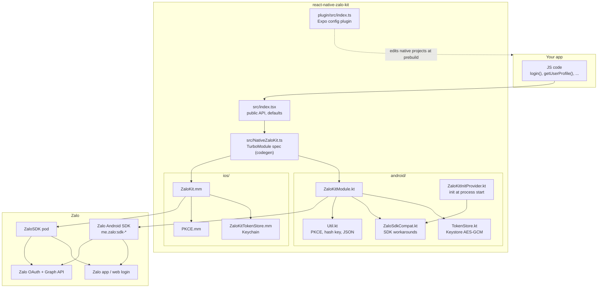
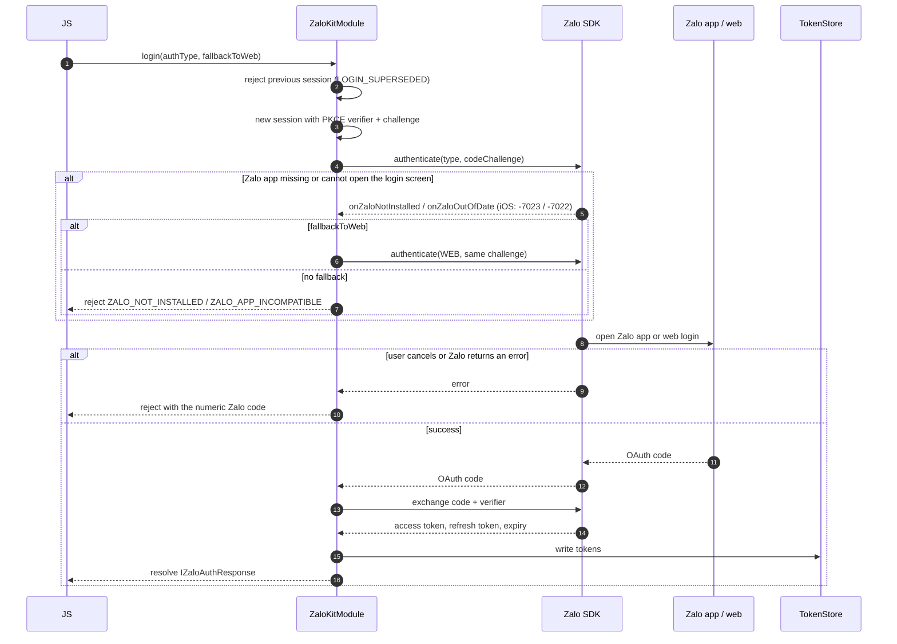
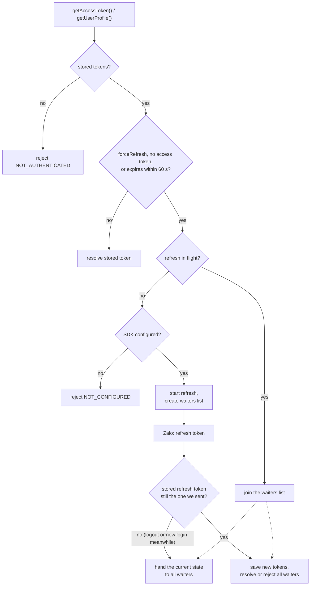
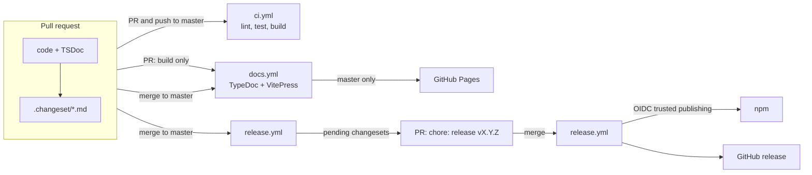

# Architecture

How react-native-zalo-kit fits together, and why some of the odd parts exist. For setup and usage, see the [documentation site](https://maitrungduc1410.github.io/react-native-zalo-kit/).

## The big picture

The library is a thin TurboModule over the official Zalo SDKs. The JavaScript layer only fills in defaults and maps options to the flat native call. Everything stateful (the login in progress, the stored tokens, the refresh in flight) lives in native code, once per platform.



## Layers

### JavaScript (`src/`)

- `NativeZaloKit.ts` is the codegen spec. It is the single source of truth for the native method signatures and the shapes of `IZaloAuthResponse` and `IUserProfile`. Changing it changes the generated Android and iOS interfaces.
- `index.tsx` is the public API. It turns `login(type, options)` into the flat `login(authType, fallbackToWeb)` native call, decides the default for `fallbackToWeb`, maps `getAccessToken({ forceRefresh })` to a boolean, and throws on iOS for `getApplicationHashKey()`. It also exports `Constants`, `ErrorCodes` and the types.
- TypeDoc builds the API reference on the docs site from `index.tsx`, including the types it re-exports from `NativeZaloKit.ts`. The TSDoc comments in both files are therefore user-facing documentation.

There is no Old Architecture bridge. The module only exists as a TurboModule.

### Android (`android/`)

| File | Role |
| --- | --- |
| `ZaloKitModule.kt` | The module. Login sessions, token refresh, profile, logout. |
| `TokenStore.kt` | Encrypted token storage. AES-GCM key in the Android Keystore, ciphertext in SharedPreferences. Falls back to memory when the Keystore is broken. Migrates the plaintext tokens that 5.x kept in the default SharedPreferences. |
| `ZaloSdkCompat.kt` | Everything that works around the closed-source SDK: lazy init from the manifest meta-data, and resetting the `bIsZaloOutOfDate` flag. |
| `ZaloKitInitProvider.kt` | A `ContentProvider` that initializes the SDK at process start, so apps no longer call `ZaloSDKApplication.wrap(this)`. |
| `ZaloKitPackage.kt` | TurboModule registration. |
| `Util.kt` | JSON to `WritableMap`, PKCE helpers, hash key (delegated to the SDK so it matches the `sign_key` Zalo checks). |
| `build.gradle` | Pulls `me.zalo:sdk-core`, `sdk-auth` and `sdk-openapi` and adds Zalo's Maven repository to every project in the build. |
| `consumer-rules.pro` | ProGuard / R8 keep rules for `com.zing.zalo.**`, shipped to apps automatically. |

All mutable state in `ZaloKitModule` (`loginSession`, `refreshWaiters`) is only touched on the main thread. Every SDK callback hops back to the main thread before it reads or writes that state, so none of it needs locks.

The module listens to `onActivityResult` itself and forwards Zalo's request codes to the SDK, so `MainActivity` needs no changes.

### iOS (`ios/`)

| File | Role |
| --- | --- |
| `ZaloKit.mm` | The module. Same responsibilities and the same state machine as the Android module. |
| `ZaloKitTokenStore.mm` | Keychain storage (`kSecAttrAccessibleAfterFirstUnlockThisDeviceOnly`), migration from the 5.x `NSUserDefaults` entry, and clearing the session after a reinstall. |
| `PKCE.mm` | Code verifier and challenge. |

`ZaloKit.podspec` at the repository root declares the pod and its dependency on `ZaloSDK ~> 4.1`.

`methodQueue` is the main queue, so like on Android all state is confined to one thread. The SDK is initialized lazily from `ZaloAppID` in `Info.plist`.

Keychain items survive uninstalling the app but `NSUserDefaults` does not. The token store writes a marker to `NSUserDefaults` and drops the Keychain item when the marker is missing, so a reinstall starts logged out, the same as on Android.

### Expo config plugin (`plugin/`)

`app.plugin.js` points at `plugin/build`, compiled from `plugin/src/index.ts`. The plugin takes `{ appId }` and writes the same native setup the docs describe for React Native CLI apps: the string resource, manifest meta-data and `BrowserLoginActivity` on Android, and `Info.plist` keys plus an `openURL` hook in `AppDelegate` on iOS. Each step checks for what is already there, so running prebuild again changes nothing.

The `AppDelegate` edit is a regex over the generated source and supports the Swift `ExpoAppDelegate` template and the Objective-C one. When it cannot find `application(_:open:options:)` it fails with a pointer to the manual setup instead of guessing.

## Login

`login()` keeps one *login session* object per call. Only the current session may settle its promise. Starting a new login, or calling `logout()`, rejects the previous session with `LOGIN_SUPERSEDED`, and any late SDK callback for an old session is ignored.



The web fallback is tried at most once per session. A session also remembers that it already received an OAuth code, because some apps still forward `onActivityResult` manually and the SDK then reports a second, bogus "cancelled" result.

### The `bIsZaloOutOfDate` flag (Android)

When the Zalo app fails to open once, the Android SDK sets a private `Authenticator.bIsZaloOutOfDate` field and never clears it. After that, every app login in the same process is silently dropped and the promise would hang forever. `ZaloSdkCompat.resetOutOfDateFlag()` clears it by reflection before each attempt. It is the only reflection in the library and is the first thing to check when upgrading the SDK version.

## Tokens

Zalo refresh tokens are single-use: refreshing returns a new refresh token and invalidates the old one. Two refreshes racing with the same token would leave one of them, and possibly the stored session, holding a dead token. So both platforms funnel every refresh through one function that keeps a list of waiters.



`isAuthenticated()` asks Zalo whether the stored refresh token is still valid. If a refresh is in flight it joins the waiters instead, because checking a token that is about to be rotated would report a logout that did not happen. Network errors reject instead of resolving `false` for the same reason.

`getUserProfile()` retries once after a forced refresh when Zalo answers with one of the access token errors (`-124`, `-216`, `-220`, `-5004`).

## Errors

Native code rejects with either one of the string codes in `ErrorCodes` (`ZALO_NOT_INSTALLED`, `NOT_AUTHENTICATED`, ...) or Zalo's own numeric code as a string. The string codes are defined three times, in `src/index.tsx`, `ZaloKitModule.kt` and `ZaloKit.mm`, and must stay identical.

## Docs and release



- `docs/` is a VitePress site in English, Vietnamese (`docs/vi/`) and Simplified Chinese (`docs/zh/`). The API reference in `docs/api/` is generated by TypeDoc from `src/index.tsx` on every build and is shared by all three languages.
- Releases go through Changesets. `scripts/changeset.mjs` hides `yarn.lock` while the CLI runs, otherwise Changesets sees a Yarn monorepo made of `example/` and `docs/` and cannot find the library. Publishing uses npm trusted publishing, so no npm token is stored anywhere.

## Repository layout

```
src/            public API and TurboModule spec
android/        Kotlin module, token store, SDK workarounds
ios/            Objective-C++ module, Keychain store, PKCE
plugin/         Expo config plugin (built to plugin/build)
example/        example app (yarn workspace)
docs/           documentation site (yarn workspace)
scripts/        Changesets wrapper and release notes extraction
.changeset/     pending changesets and Changesets config
.github/        CI, docs and release workflows
```
