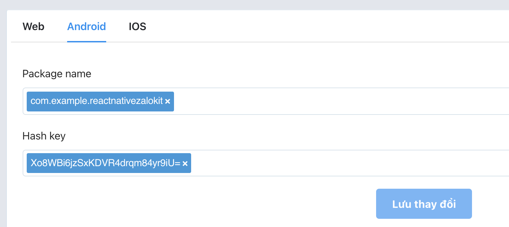
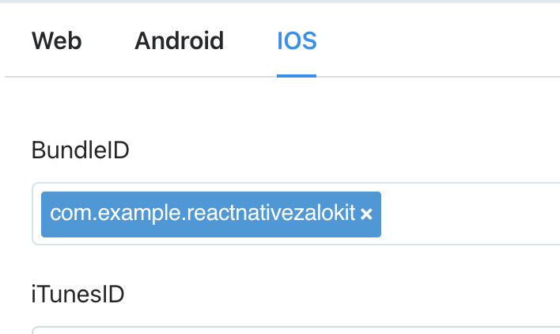
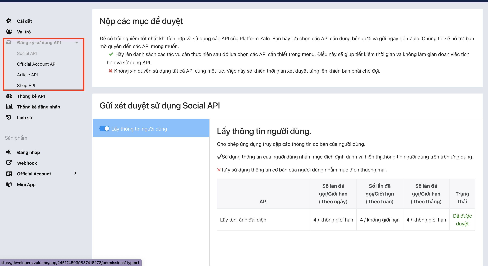

# Tạo ứng dụng Zalo

1. Tạo ứng dụng trên [Zalo Developer Portal](https://developers.zalo.me/).
2. Vào `Sản phẩm > Đăng nhập` và cấu hình cho Android và iOS:

<div class="portal-shots">
  
  
</div>

- **Android**: package name và hash key của chứng chỉ ký app. Xem phần [Hash key](#hash-key) bên dưới.
- **iOS**: bundle ID.

3. Ghi lại **Zalo App ID** (một dãy số). Bước thiết lập nào cũng cần đến nó.
4. Xin các quyền mà app cần, rồi chuyển app sang `Live Mode` để dùng được đầy đủ tính năng.



## Hash key {#hash-key}

Hash key trên Android là chuỗi SHA-1 (mã hóa Base64) của chứng chỉ đã ký app. Mỗi khóa ký có một hash key riêng, nên bản build nào bạn phát hành thì phải khai báo hash key của bản đó.

### Lấy từ app đang chạy {#from-the-running-app}

[`getApplicationHashKey()`](/api/functions/getApplicationHashKey) trả về hash key của bản build đang chạy, tính giống hệt cách Zalo SDK tính:

```ts
import { getApplicationHashKey } from 'react-native-zalo-kit';

console.log(getApplicationHashKey());
```

### Khi dùng Play App Signing {#for-play-app-signing}

Nếu bật Play App Signing, Google sẽ ký lại app của bạn, nên bản cài từ Google Play có hash key khác với bản build local hay bản upload. Lấy SHA-1 của **App signing key certificate** trong Play Console (`Test and release > Setup > App signing`) rồi chuyển đổi:

```sh
echo "<SHA-1, ví dụ AB:CD:...>" | tr -d ':' | xxd -r -p | base64
```

### Lấy từ keystore {#from-a-keystore}

```sh
keytool -exportcert -alias <alias> -keystore <keystore> | openssl sha1 -binary | openssl base64
```
