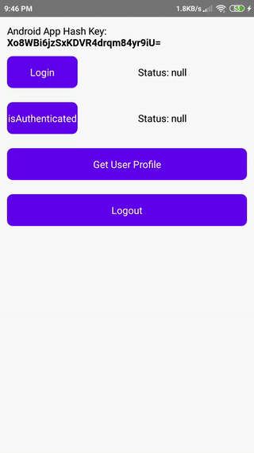

<div class="home-section vp-doc">

## Cài đặt {#install}

::: code-group

```sh [npm]
npm install react-native-zalo-kit
cd ios && pod install
```

```sh [yarn]
yarn add react-native-zalo-kit
cd ios && pod install
```

```sh [Expo]
npx expo install react-native-zalo-kit
# thêm plugin vào app.json, rồi chạy
npx expo prebuild
```

:::

Sau đó [tạo ứng dụng Zalo](/vi/guide/zalo-app) và làm theo hướng dẫn thiết lập cho [Expo](/vi/guide/expo), [iOS](/vi/guide/ios) hoặc [Android](/vi/guide/android).

## Đăng nhập và lấy thông tin người dùng {#sign-in-and-read-the-profile}

```ts
import { getUserProfile, login } from 'react-native-zalo-kit';

await login();
const { id, name, picture } = await getUserProfile();
```

## Chạy thử trên thiết bị {#see-it-on-a-device}

<div class="demo-shots">
  <figure>
    
    <figcaption>Android</figcaption>
  </figure>
  <figure>
    
    <figcaption>iOS</figcaption>
  </figure>
</div>

</div>
